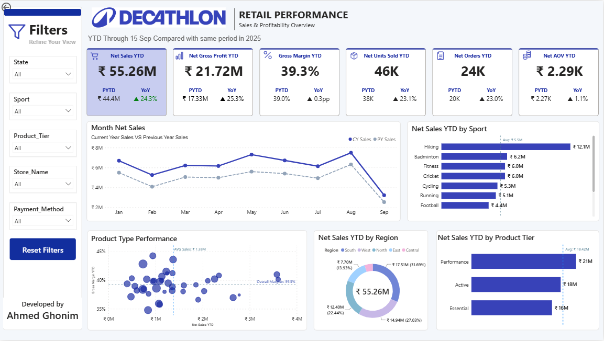
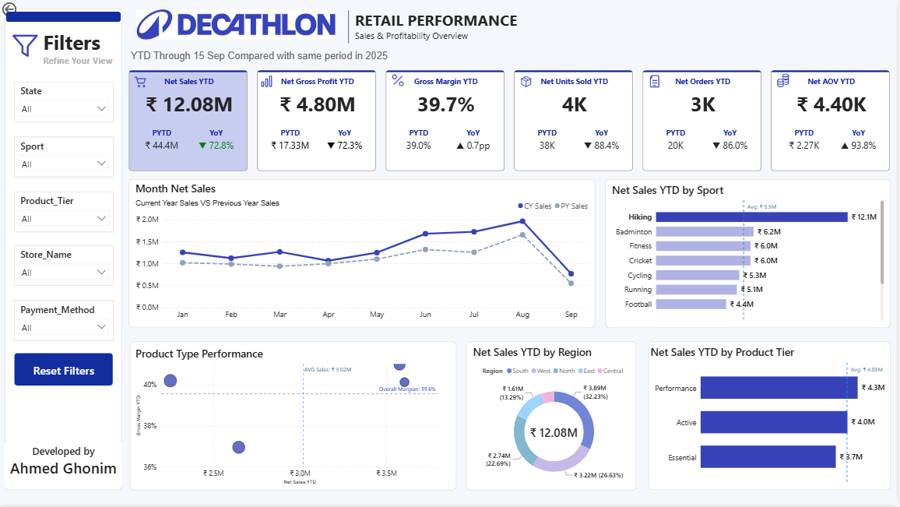
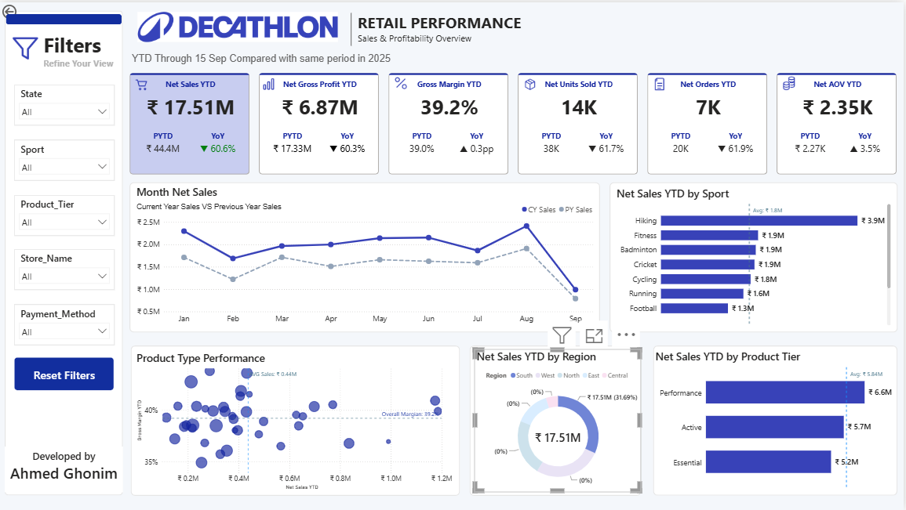

# 🏅 Decathlon Retail Performance Dashboard

An interactive **Power BI** dashboard that tracks sales and profitability for a sports retailer, comparing **YTD (through 15 Sep)** with the same period last year.



## 🎯 Business Questions

- How are sales and profit performing compared to last year?
- Which sports, regions, and product tiers drive the most revenue?
- Is growth coming from more orders or from bigger orders?
- Which product types have strong margins and strong sales?

## 📊 Key Results

| KPI | Value | vs. Last Year |
|---|---|---|
| Net Sales | ₹55.26M | ▲ 24.3% |
| Gross Profit | ₹21.72M | ▲ 25.3% |
| Gross Margin | 39.3% | ▲ 0.3 pp |
| Units Sold | 46K | ▲ 23.1% |
| Orders | 24K | ▲ 23.0% |
| Avg. Order Value | ₹2.29K | ▲ 1.1% |

## 💡 Key Insights

- **Growth comes from volume, not price.** Sales grew 24.3% and orders grew 23.0%, while average order value grew only 1.1%.
- **Hiking is the top sport** with ₹12.1M, about double the next sport (Badminton, ₹6.2M).
- **South is the strongest region** with 31.7% of net sales.
- **Margins are stable** at about 39%, so growth did not come from discounting.
- **Current year beats last year in every month** from January to August.

## 🧰 Tools & Skills

- **Power BI** – data modeling, visuals, interactive filters
- **DAX** – time intelligence (YTD, PYTD, YoY) and KPI measures
- **Data modeling** – star schema

## 🖼️ Screenshots

**Filtered by sport (example: Hiking)**



**Filtered by region (example: South)**



## 🖱️ Dashboard Features

- Filters: State, Sport, Product Tier, Store, Payment Method
- Current year vs. previous year trend
- Product type bubble chart (sales vs. margin)
- Sales by sport, region, and product tier

## 📁 Project Structure

```
├── Decathlon.pbip
├── images/
│   ├── dashboard.png
│   ├── hiking-view.png
│   └── south-view.png
└── README.md
```

## ▶️ How to Open

1. Install **Power BI Desktop**.
2. Download this repo.
3. Open `Decathlon.pbip`.

## 📝 Notes

- September is partial (through 15 Sep), so its drop is expected.
- Data source: *(write here: where the data came from, e.g. public dataset or synthetic data)*.

## 👤 Author

**Ahmed Ghonim** – Data Analyst
[GitHub](https://github.com/A7medGhonim) · [LinkedIn](ضع-رابطك-هنا)
